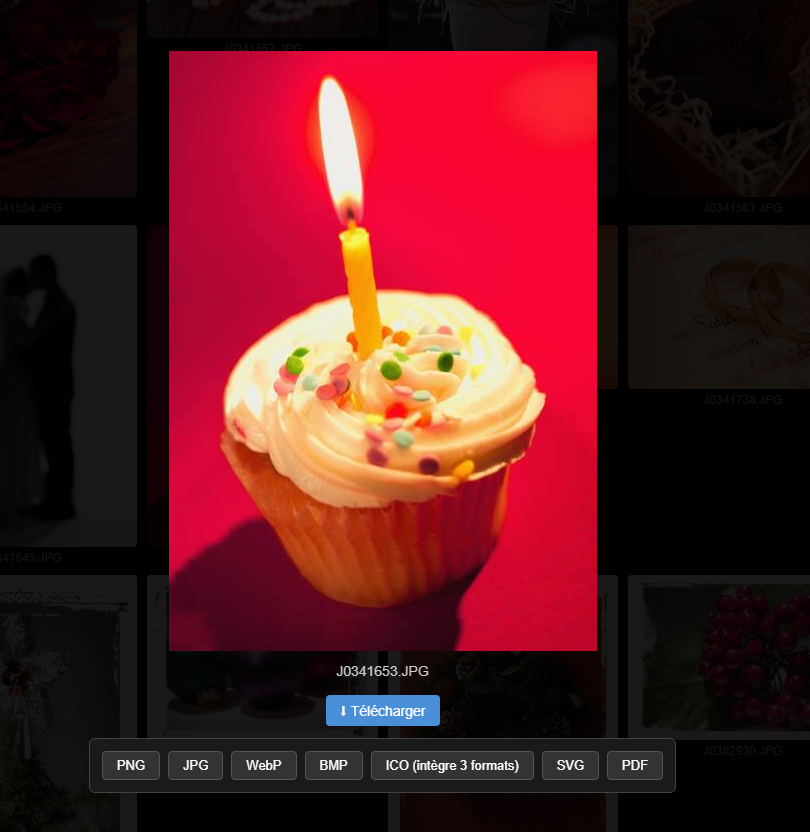

# View Picture and Converter           

Voir les images d'un dossier (et sous dossier) et pouvoir les convertir

++ Fonctionne sur PC et Androïd (Apple non testé)

### Formats d'export supportés :
- PNG
- JPG
- WEBP
- BMP
- ICO
- SVG
- PDF

PAGE directement utilisable ici :

[https://mephisto68.github.io/View-picture-and-converter](https://mephisto68.github.io/View-picture-and-converter/)

Capture :

## Comment l'utiliser :
1. Sélectionnez un dossier contenant vos images.
2. Accepter l'import
3. Accepter ou annuler l'import des sous-dossiers
4. Cliquez sur une image
5. Choisissez le format de sortie souhaité.
6. Cliquez sur "Ok".
7. Selectionner une autre image ou un autre dossier
8. Pour annuler la conversion il suffit à tout moment de cliquer en dehors de l'image.
9. Merci à l'IA Leo !
